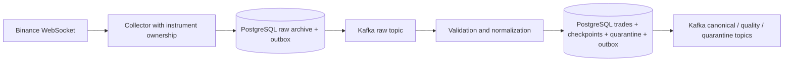

# FinRisk Sentinel

FinRisk Sentinel detects unusual daily price/volume patterns and explains portfolio exposure for Moroccan and international equity workflows. The current implementation includes a durable Binance pipeline, authenticated team workspaces, expiring invitations and role management, versioned workspace plans with server-enforced quotas, an equity catalog, a transaction ledger with validated CSV imports, persistent daily-market imports, FX-aware valuations, a portfolio Risk Lab with tail-risk, drawdown, concentration, stress, and position-attribution evidence, saved watchlists with explainable alerts, a browser dashboard, and isolated paper trading. [External browser sign-in](docs/browser-sign-in.md) supports Authorization Code + PKCE and requires a configured identity provider. Live equity feeds, payment collection, and real broker execution still require external integrations. The built-in demo uses fictional data.

See the [API foundation](docs/api-foundation.md), [portfolio ledger](docs/portfolio-ledger.md), and [instrument catalog](docs/instrument-catalog.md) for setup and endpoints. The catalog and provider boundary are implemented; live equity feeds still need provider access. The [target architecture](docs/architecture.md) describes the broader roadmap.

The [account model](docs/account-model.md) documents registration identity, first-login provisioning, and tenant isolation. The [team workspace flow](docs/team-workspaces.md) documents invitations and roles, [portfolio Risk Lab](docs/portfolio-risk-lab.md) documents the analytics method and evidence contract, and [risk alerts](docs/risk-alerts.md) documents saved rules, scans, evidence, and acknowledgment. The [SaaS delivery plan](docs/product-delivery-plan.md) orders the remaining product, external API, professional web, native-compute, and production work.
Current market-data, broker, and billing constraints are recorded in the [provider decision brief](docs/provider-integration-decisions.md).

## Current pipeline



Events are persisted before acknowledgment. Redelivery is deduplicated; malformed records are quarantined; old trades remain available for history. Exact decimal values and 64-bit sequence IDs serialize as strings in the [versioned JSON contracts](contracts/events).

## Run locally

For the complete browser demo (portfolio valuation, daily anomalies and paper trading), see the [application workflow](docs/application-workflow.md). After the initial environment setup below:

```sh
docker compose -f docker-compose.yml -f compose.demo.yml up -d --build api
docker compose -f docker-compose.yml -f compose.demo.yml run --rm --no-deps bootstrap python scripts/seed_demo_market.py
```

Open http://localhost:8000 and choose a local demo identity. The public site and authenticated trading workspace are built with Next.js 16, React 19, and Tailwind CSS 4; FastAPI serves the optimized static export on the same origin as the API. Real equity feeds and broker execution are not connected. The original pipeline commands below run the Binance data foundation.

Requires Docker Desktop/Engine, Python 3.12.12, and uv 0.10.12.

For frontend-only development, use Node 24:

```sh
cd apps/web
npm install
npm run dev
```

`npm run build` type-checks and exports the production frontend into `services/api/static`. The Docker build performs the same Next.js production build from the locked npm dependencies.

```sh
uv sync --locked
uv run python scripts/init_local_env.py
docker compose up -d --build
docker compose --profile tools run --rm inspect
```

The initializer preserves an existing modern `.env`; run it only for initial setup. Kafka/PostgreSQL have persistent volumes and no published host ports. Compose is explicitly for local development: its private broker listener is plaintext. Production settings fail closed unless Kafka uses SASL/TLS and PostgreSQL verifies TLS certificates.

Check health inside a running container:

```sh
docker compose exec ingestion python -c "import urllib.request; print(urllib.request.urlopen('http://localhost:8080/ready').read().decode())"
docker compose logs --tail 30 market_data ingestion
docker compose stop
```

`/live`, `/ready`, and `/metrics` listen internally on port 8080 in each service. Freshness is separate from process liveness. Never expose the broker/database or these operational endpoints publicly.

## Verify

```sh
uv run ruff check .
uv run ruff format --check .
uv run pytest -q -m "not integration"
docker compose -f docker-compose.yml -f compose.test.yml build
docker compose -f docker-compose.yml -f compose.test.yml run --rm tests
uvx pip-audit -r requirements.lock --disable-pip --no-deps
```

Integration tests create isolated database schemas and uniquely named Kafka topics; they do not truncate application tables. Runtime package versions and hashes are recorded in `uv.lock` and `requirements.lock`. Container base images are pinned by digest; update them deliberately and rerun checks. CI builds the images and runs both unit and real broker/database tests.

## Operations and design

- [Daily market analysis, valuation, dashboard and paper trading](docs/application-workflow.md)

- [P0?P2 implementation status and verification](docs/priority-fixes.md)
- [Recovery, replay, deployment, and monitoring runbook](docs/pipeline-operations.md)
- [Target SaaS architecture and delivery gates](docs/architecture.md)
- [Historical assessment that motivated these changes](docs/architecture-assessment.md)

The current PostgreSQL archive and ordered outbox are a correctness baseline, not the final high-throughput archive design. Benchmark and batch/partition processing before expanding the subscribed universe. Kafka replay cannot reconstruct exchange events that were never received.
