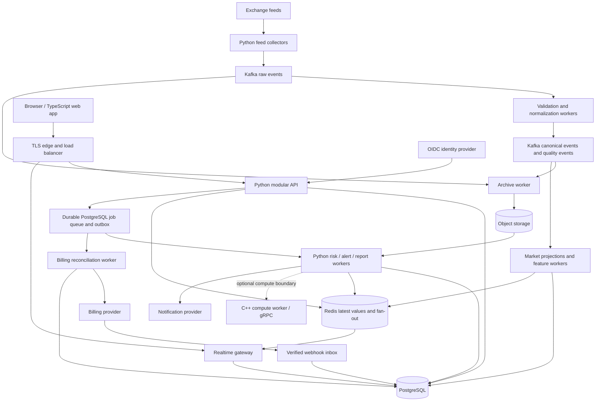

# FinRisk Sentinel architecture

Status: proposed implementation baseline, 2026-09-27. This is a design, not a claim that the components or capacity below already exist. See [the repository assessment](architecture-assessment.md) for current findings.

Implementation update: the [P0–P2 foundation](priority-fixes.md) now uses Kafka plus a PostgreSQL raw archive, transactional inbox/outbox, and durable canonical storage. JSON Schema is the current language-neutral event contract; Protobuf/gRPC and object-storage archival remain future extensions. The full SaaS layers below are still planned.

## Product assumptions

Application update: [daily-market ingestion, valuation snapshots, anomaly checks, a dashboard and isolated paper trading](application-workflow.md) now form a working local application. Live feeds, production browser identity integration and real broker execution remain external integration work; model checks have fixture validation, not demonstrated investment performance.

Catalog update, 2026-09-30: the [instrument catalog and provider boundary](instrument-catalog.md) are implemented with authenticated lookup, operator imports, transaction matching, and explicitly labelled demo quotes. Live equity-feed access and authoritative session calendars remain the next delivery step.

Product direction clarified 2026-09-30: detect anomalies and explain trading risk for Moroccan and international stock markets, with broker-backed trading inside the app planned. Risk signals must include data quality and uncertainty, including an insufficient-data state. The Binance feed is the existing technical foundation; equity feeds and exchange-aware instruments are still needed. Authenticated workspaces and portfolio metadata exist, and the [transaction ledger and holdings](portfolio-ledger.md) extend that foundation. One person gets a personal workspace using the same tenant model as a team. Broker execution is a later delivery phase; custody and ultra-low-latency trading are outside the current scope. Product audience, launch workload, budget, billing jurisdiction/provider eligibility, data redistribution rights, and anomaly/risk methodologies remain decisions to confirm before paid release.

Design for growth through independent workers, durable processing, tenant isolation, and measurable capacity. Registered user count alone cannot size this system: concurrent connections, tick throughput, portfolios, instruments per portfolio, calculation complexity, and refresh intervals determine cost.

## Architecture decisions

1. Keep Python for ingestion, application logic, and initial risk calculations. Use TypeScript for the web application. Add C++ only for measured compute bottlenecks.
2. Build one modular application API for identity integration, workspaces, portfolios, billing, entitlements, risk-job orchestration, and alerts. Modules own their tables and expose application interfaces. Avoid a network service for every module.
3. Deploy the feed collectors, normalization workers, application API, and background workers independently. Extract the realtime gateway when connection load warrants it.
4. Adopt managed Kafka as the target durable market-event backbone. Use a local broker for development; validate its cost and operations before choosing the production provider. If this is unaffordable, explicitly revisit the broker decision before implementation rather than quietly returning to lossy PUB/SUB.
5. PostgreSQL is the transactional source of truth. Object storage holds historical market partitions, imports, and report artifacts. Redis is an expendable cache and realtime fan-out channel, never the only copy of jobs, entitlements, or completed results.
6. Start with one region and managed container hosting. Production database and broker redundancy must match the chosen availability target. Kubernetes, a service mesh, ClickHouse, and multi-region writes require measured justification.

## Target system



The API and realtime gateway can initially share a deployment; risk, alert, reporting, and billing workers can share an image with separate worker commands and concurrency limits. PostgreSQL job tables are the initial durable task mechanism; Kafka carries the high-volume market stream. These have different workload and ordering requirements.

## Boundaries and ownership

| Component | Responsibility | Scaling / ownership rule |
|---|---|---|
| Collectors | Exchange connectivity, receive timestamps, source metadata, raw publication | Assign disjoint exchange/market/instrument shards with leases and fencing; adding identical replicas duplicates subscriptions |
| Normalization | Schema validation, instrument mapping, quality flags, canonical events | Traditional consumer groups; partition by exchange + market type + instrument |
| Market projections | Latest quotes, candles, common return/volatility features | Compute once per instrument/window and reuse across tenants |
| Application API | Authentication, authorization, portfolios, plans, jobs, query endpoints | Stateless replicas; bounded DB connection pools |
| Risk workers | Valuation, exposure, risk models, scenario jobs | Separate interactive and batch pools; fair per-tenant scheduling |
| Realtime gateway | Authorized subscriptions, snapshots, updates | Scale by connections, output bandwidth, memory, and send-queue depth |
| Billing module/workers | Subscription lifecycle, entitlements, reconciliation | Provider-independent domain model; idempotent inbox and mutations |
| Alert workers | Rule evaluation, cooldowns, delivery tracking | Durable alert occurrences and delivery deduplication |

Only an owning module changes its data; sharing a PostgreSQL instance does not authorize arbitrary cross-module writes. Workers use narrowly scoped roles. Customer portfolios never go into the globally shared market stream.

## Market-data correctness and recovery

Define versioned language-neutral contracts under `contracts/`, starting with Protobuf for broker events and future compute RPCs, plus OpenAPI for public HTTP. Generate language bindings; do not use Python pickle or import a Python model as the cross-language contract.

A canonical trade contains: schema version, event ID, source event/trade ID, exchange, market type, instrument ID, event timestamp, receive timestamp, normalization timestamp, exact price and quantity, and quality flags. Use decimal strings or explicitly scaled integers for exact numeric values; UTC epoch units must be named in the schema. An instrument catalog supplies assets, currency, tick size, quantity scale, and market identity. Symbols alone are not globally unique.

Use deterministic deduplication keys such as `(exchange, market_type, instrument_id, source_trade_id)` where the source guarantees this identity. Provider-specific sequence rules belong in provider adapters. Do not assume every venue's IDs are contiguous or comparable across sessions.

Validate before changing sequence state. Preserve raw input, quarantine malformed messages with reason codes, and emit quality events for gaps, skew, or lateness. Late historical trades can be valid: keep them for history while withholding them from the live latest-price projection. Replay uses event time and an explicit replay mode, not the current five-second wall-clock rejection.

Use at-least-once delivery and idempotent side effects. Acknowledge/commit only after durable effects. For normalization, use Kafka transactions for output plus consumed offsets where supported, or deterministic output IDs with downstream deduplication. This does not make external database writes or notifications exactly-once. Partition checkpoints must survive reassignment; a process-local dictionary is not sufficient. Keep processing ordered within each partition and make partition-count changes a deliberate migration.

Use producer acknowledgments and replication settings consistent with the durability objective; make retention and disk alerts explicit. Kafka orders records within a partition and traditional consumer groups distribute partitions among workers. [Kafka design](https://kafka.apache.org/41/design/design/).

On an upstream outage or unacknowledged publish, mark the feed degraded, reconnect with bounded jittered backoff, and recover from the provider's supported history endpoints where possible. A broker cannot restore ticks never received. If a gap cannot be repaired, preserve the gap and mark affected outputs incomplete. On overload, bound queues and apply explicit backpressure; do not silently sample the archival stream. Live UI updates may be coalesced.

Archive raw and canonical data to time/instrument-partitioned objects with checksums and manifests. Broker retention covers operational replay; object storage covers longer research/recompute windows. Set lifecycle durations after measuring volume and confirming product/data-source constraints.

## Tenant data and authorization

Initial tables/modules:

| Domain | Principal tables |
|---|---|
| Identity and tenancy | users, workspaces, memberships, invitations, service_credentials |
| Portfolios | portfolios, portfolio_transactions, position_snapshots, import_jobs |
| Market reference | instruments, market_snapshots, candle_windows, data_quality_intervals |
| Risk | risk_jobs, risk_results, model_versions, input_snapshot_manifests |
| Alerts | alert_rules, alert_occurrences, notification_deliveries |
| Billing | billing_customers, subscriptions, plan_versions, entitlements, webhook_inbox, usage_ledger |
| Operations | job_queue, outbox, audit_events |

All private records carry `tenant_id`; use tenant-scoped indexes, uniqueness, and foreign keys so a portfolio reference cannot cross workspaces. Authenticate through OIDC, resolve membership server-side, and enforce owner/admin/member/viewer permissions at each operation. Never trust a tenant ID merely because it appears in a request or queue payload.

Add PostgreSQL row-level security as defense in depth. Use a non-owner application role without `BYPASSRLS`, appropriate `FORCE ROW LEVEL SECURITY`, and transaction-local tenant context with pooled connections. Migration/admin roles remain separate. Owners and privileged roles can otherwise bypass policies. [PostgreSQL row security](https://www.postgresql.org/docs/17/ddl-rowsecurity.html).

Scope cache keys, signed artifact URLs, background jobs, audit records, and websocket channels by tenant. Recheck membership/entitlements on reconnect and invalidate active sessions/subscriptions after revocation. Every request must authorize the requested resource. Test isolation across HTTP, SQL, jobs, downloads, and realtime messages, including connection-pool reuse.

Store exact holdings and transactions with decimal arithmetic. Derive versioned positions from imported/manual transactions with import idempotency. Risk results reference immutable portfolio and market snapshots; a changing current-position row is not a reproducible calculation input.

## Subscriptions and quotas

Bill a workspace, not an individual login. Version plans independently of payment-provider price IDs. Start with flat subscription tiers and explicit usage limits; add usage billing only when a durable usage ledger and reconciliation exist. Candidate entitlements: seats, portfolios, instruments, active alert rules, history depth, refresh cadence, API rate, simultaneous jobs, and monthly compute budget. Prices and exact tier limits are product decisions.

Use hosted checkout and customer billing management through an eligible provider. Stripe is a reference integration, subject to merchant jurisdiction and payment-method support. Keep provider calls behind a billing adapter. The browser checkout redirect never grants paid access.

Webhook workflow: verify signature against the raw request body, insert a unique provider/event ID into a durable inbox, acknowledge after persistence, then process asynchronously. Serialize reconciliation per subscription, fetch authoritative current state when handling lifecycle notifications, and update subscription and entitlement projections transactionally. Retry failures and reconcile periodically so a missed webhook does not permanently drift access. Webhook delivery can repeat and arrive out of order. [Stripe webhook behavior](https://docs.stripe.com/webhooks).

Model pending/incomplete, trial, active, past-due, unpaid, canceled, and paused states where the provider supports them. Define grace periods explicitly. Cancellation at period end retains access until the recorded end; immediate cancellation and charge disputes follow an explicit product policy. Apply downgrades without deleting customer portfolios. Keep entitled refresh limits separate from data retention rules.

Enforce limits at API entry and job dispatch, and recheck relevant limits before expensive execution. Reserve quota atomically to prevent concurrent requests overspending; finalize or release reservations idempotently. Scope counters to tenant and billing period. During billing-provider outages use the last verified entitlement with a bounded policy; reject unverified upgrades. Audit manual overrides with expiry and actor.

## Risk computation and C++ path

Initial calculation boundary: input snapshot + model/version + parameters -> typed result + provenance + quality. Start with valuation, allocation/concentration, exposure, and well-specified historical metrics. VaR, expected shortfall, covariance, and stress scenarios require explicit horizon, sampling, currency conversion, missing-data rules, lookback, and validation fixtures. They are candidate modules, not already validated financial models.

Every result records portfolio version, market snapshot/window, model version, parameters, random seed if applicable, start/end times, numeric units, and data freshness/completeness. Shared market features reduce repeated work. Schedule/coalesce dirty portfolios according to plan cadence; do not launch a complete risk calculation for every tick for every customer. Reject obsolete results from overwriting newer projections.

Run CPU-heavy work outside the API event loop in processes. Profile vectorized Python/numerical libraries before rewriting. Introduce C++ when a measured kernel dominates latency/cost and fails the defined budget after Python optimization.

Two supported paths: a native extension for a stable in-process numerical kernel, or a separate C++ worker using broker contracts and optional gRPC for bounded synchronous computation. Prefer a worker for long jobs, fault isolation, or independently scaled compute. Protobuf/gRPC supports generated C++ service contracts. [gRPC C++ basics](https://grpc.io/docs/languages/cpp/basics/).

Batch calls to amortize serialization. Specify numeric precision, overflow, rounding, cancellation, deadlines, input size limits, and version compatibility. Financial records remain exact decimal; floating-point analytics require documented tolerances. Require cross-language golden datasets and differential results before routing production work to C++. Keep authentication, billing, and product orchestration in the application layer.

## API and realtime behavior

Version routes under `/v1`; use cursor pagination and idempotency keys on costly mutations. Examples: portfolios, imports, risk-jobs, results, alert-rules, billing checkout, and subscription status. Long calculations return `202` plus a job ID; clients retrieve status or receive an authorized completion event. Set request deadlines, payload limits, per-user/tenant rate limits, and bounded database queries.

Realtime clients load an authorized snapshot, then receive versioned updates with a cursor. Redis fan-out is transient; after gaps or reconnects fetch a new durable snapshot. Each gateway must receive the events needed by its own connections: placing all gateways in one competing consumer group would send each update to only one gateway. Scope channels by tenant, cap subscriptions, coalesce replaceable prices, and disconnect slow clients with resync instructions. Durable alerts/results remain queryable even if push delivery is missed.

## Deployment, security, and operations

Local: Compose for API, workers, broker, PostgreSQL, Redis, and an object-storage emulator as needed. Staging mirrors production protocols and managed-service settings. Production: TLS load balancer, stateless container replicas, private database/broker/cache, managed secrets, least-privilege service credentials, encrypted backups, and controlled outbound provider access.

Use reproducible dependency locks, supported pinned runtime versions, non-root minimal images, image/dependency scanning, schema compatibility checks, and automated migrations. Run migrations once per release; use expand/contract changes for rolling deployment compatibility. Separate liveness from readiness and feed freshness. Shut down by stopping intake, finishing or releasing jobs, committing successful work, and closing resources within a deadline.

Collect structured logs and traces with request/job/event identifiers; exclude secrets and unnecessary customer payloads. Metrics include source lag, consumer lag, gap counts, rejection causes, reconnects, archive failures, job age, API latency/errors, DB pool pressure, socket send queues, billing reconciliation age, and notification delivery outcomes. Avoid tenant IDs as unbounded metric labels. Alert on user impact and stale/degraded risk outputs.

Use point-in-time database recovery, object versioning/lifecycle rules where appropriate, broker redundancy, and regularly tested restores. Initial proposed objectives: 99.9% monthly API availability, API p95 under 300 ms for bounded reads, quote freshness p95 under 2 seconds when upstream is healthy, transactional RPO at most 5 minutes and RTO at most 60 minutes. These are engineering targets requiring a funded deployment and tests, not promises. Risk-job latency needs a defined model/portfolio benchmark.

## Capacity proof and growth triggers

Initial qualification envelope (assumption): 10,000 registered users, 1,000 simultaneous sessions, 500 portfolios due per minute, and 5,000 market events/second. Test with representative portfolios and event sizes, not tiny synthetic payloads only. At 500 bytes/event, that event rate is about 216 GB/day before replication, indexes, raw-plus-canonical duplication, and compression. This makes retention a budget decision from the start.

Measure separately: API requests/second, live fan-out messages/second, broker bytes/second, worker CPU-seconds/job, active partitions, queue drain rate, database I/O, and storage growth. Benchmark normal load, a 3x burst, a hot instrument, a noisy tenant, reconnect storms, and a prolonged outage/replay. Require stable memory, bounded queues, no cross-tenant results, and eventual catch-up without corrupting data.

Scale API replicas for request pressure, gateways for connections/egress, and workers for queue age and CPU. Preserve DB connection budgets as replicas grow. Scale normalizers up to partition parallelism; split collector shards rather than duplicating feeds. Add read replicas after query/index work, and ClickHouse only when historical analytical queries measurably conflict with transactional workloads. Extract application modules only when independent deployment or ownership provides a demonstrated benefit.

## Delivery order and gates

| Phase | Deliverable | Gate before advancing |
|---|---|---|
| 0: stabilize | Validation, secret hygiene, correct configuration, lifecycle, repeatable builds/tests | Malformed input cannot kill pipeline; shutdown/reconnect tests; documented encrypted/private boundaries |
| 1: trustworthy data | Versioned contracts, durable broker, deduplication, archives, replay, quality metrics | Kill/restart/replay tests reproduce canonical output; gaps and poison messages visible; checkpoint recovery works |
| 2: tenant foundation | Modular API, identity, workspaces, PostgreSQL migrations/RLS, portfolio import | Tenant-isolation and concurrency tests pass; auditable imports and restorable database |
| 3: risk vertical slice | One defined calculation, durable jobs, dashboard, bounded realtime, alerts | Reproducible model fixtures; freshness visible; duplicate jobs/deliveries handled |
| 4: paid access | Provider integration, entitlement policies, quotas, billing portal | Duplicate/out-of-order/missed webhook tests, renewal/cancel/grace tests, concurrent quota tests |
| 5: production readiness | Load tests, restore drills, operational dashboards, cost model, staged rollout | Workload envelope and SLOs demonstrated; incident/runbook ownership established |
| 6: measured growth | Additional models, C++ kernels, analytics store, further service extraction | Each addition justified by measured bottleneck and regression benchmarks |

Phases 0 and 1 have an implemented baseline; phase 2 now includes authenticated workspaces and a manual ledger with holdings. Next delivery work is equity instruments/feeds, portfolio valuation, and evaluated anomaly signals with a dashboard. Broker-backed order execution follows with its own lifecycle and reconciliation controls. Imports, restore certification, and other outstanding delivery gates remain necessary.

## Proposed repository shape

```text
apps/web/                       TypeScript UI
services/api/                   Python application and domain modules
services/market_data/           Existing collectors, hardened
services/ingestion/             Existing normalizers, durable transport
services/workers/               Risk, archive, alerts, billing worker commands
services/realtime/              Extract when needed
contracts/events/              Versioned broker schemas
contracts/rpc/                 Future compute service contracts
packages/risk_core/             Python calculation domain
native/risk_core/               Future measured C++ kernels
infra/                         Local deployment and production IaC
tests/integration/             Broker/database/billing failure cases
tests/load/                    Repeatable workload envelopes
docs/                          Architecture, decisions, runbooks
```

Create folders as functionality arrives. Keep contract packages small and domain logic owned by its module.
